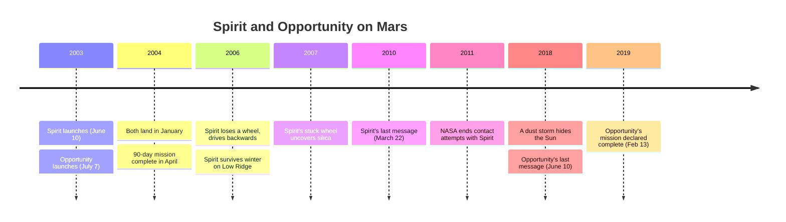
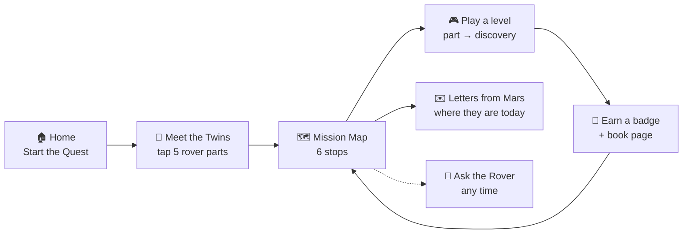

<div align="center">


# 🚀 Twin Rover Quest

### Two robots. Built for 90 days. Never forgotten.

A story-game website that tells children under 10 the true story of **Spirit** and **Opportunity**,<br>the twin NASA rovers left on Mars.

<a href="https://phoniexteam52-lgtm.github.io/The-CIS-Galaxy-Express/"></a>

<a href="https://www.spaceappschallenge.org"></a>


**Team The CIS Galaxy Express** · Creatives International Schools · Cairo, Egypt 🇪🇬

<br>


<sub><i>Level 1 · Crash Landing: open the parachute, inflate the airbags, fire the rockets, cut the cord.</i></sub>

</div>

<br>

<table align="center">
<tr>
<td align="center"><a href="https://phoniexteam52-lgtm.github.io/The-CIS-Galaxy-Express/">🏠<br><b>Home</b></a></td>
<td align="center"><a href="https://phoniexteam52-lgtm.github.io/The-CIS-Galaxy-Express/#twins">🤖<br><b>Meet the Twins</b></a></td>
<td align="center"><a href="https://phoniexteam52-lgtm.github.io/The-CIS-Galaxy-Express/#map">🗺️<br><b>Mission Map</b></a></td>
<td align="center"><a href="https://phoniexteam52-lgtm.github.io/The-CIS-Galaxy-Express/#level1">🪂<br><b>Play Level 1</b></a></td>
<td align="center"><a href="https://phoniexteam52-lgtm.github.io/The-CIS-Galaxy-Express/#finale">✉️<br><b>Letters from Mars</b></a></td>
<td align="center"><a href="https://phoniexteam52-lgtm.github.io/The-CIS-Galaxy-Express/#grownups">👨‍👩‍👧<br><b>For grown-ups</b></a></td>
</tr>
</table>

---

## 📑 Contents

| | | |
| --- | --- | --- |
| [✨ Summary](#-summary) | [🗺️ Mission Map and levels](#️-the-mission-map-and-levels) | [🛠️ Technology](#️-technology) |
| [🎯 The challenge](#-the-challenge) | [💬 Ask the Rover](#-ask-the-rover) | [💻 Run it locally](#-run-it-locally) |
| [📅 The real story](#-the-real-story) | [📖 The printed book](#-the-printed-cartoon-book) | [🛰️ NASA data](#️-nasa-data-and-resources) |
| [🎮 How a child plays](#-how-a-child-plays) | [🧒 Designed for children](#-designed-for-children) | [📚 Other resources](#-other-data-resources-and-tools) |
| [🤖 Meet the twins](#-meet-the-twins) | [✅ Built vs concept](#-what-is-built-and-what-is-concept) | [🧠 Use of AI](#-use-of-ai) |
| [🖼️ Screenshots](#️-screenshots) | [🌍 Impact](#-impact-and-next-steps) | [👥 Team](#-team) |

---

## ✨ Summary

Twin Rover Quest is a story-game website that tells children under 10 the true story of Spirit and Opportunity, the twin NASA rovers left on Mars. Built for a 90-day mission, Spirit kept working for more than six years and Opportunity for more than fourteen. Both are still on Mars today, silent.

Children meet the twins and tap their parts to learn what each one did. Then they play through the rovers' journey on a Mission Map of five levels and a finale. Each level links **one engineering part to one real discovery**. Players earn badges, ask the rovers questions in a helper that answers only from NASA facts, and end by reading each robot's imagined letter.

Every fact links to its NASA source, and imagined voices are clearly labelled. **Level 1 is fully playable** in our prototype; Levels 2 to 5 are designed as concept screens.

<div align="center">

| 🗓️ Planned mission | 🔴 Spirit worked | 🔵 Opportunity worked | 🎮 Levels | 🏅 Badges | ⏱️ Play time |
| :---: | :---: | :---: | :---: | :---: | :---: |
| **90 days** | **6+ years** | **14+ years** | **5 + finale** | **6** | **15–20 min** |

</div>

---

## 🎯 The challenge

> **Abandoned but not Forgotten: Storytelling about NASA's Discarded Equipment on the Moon and Mars**

We chose two machines NASA left on Mars: the twin rovers **Spirit** and **Opportunity**. They landed in January 2004 with a 90-day plan, and they kept exploring for years. Today they are still on Mars, silent, where they finished their missions. Most children have never heard of them.

**Our question:** *how can a child under 10 feel why these robots matter, and still learn only true facts?*

**Our answer:** turn their real journey into a story a child can play, where every fact comes from NASA and every imagined voice is labelled as imagined.

---

## 📅 The real story



---

## 🎮 How a child plays



In 15 to 20 minutes, a child:

1. **Meets the twins** and taps five rover parts to learn what each one does.
2. **Plays five short levels:** landing, digging, winter, the water clues and the dust storm.
3. **Collects one badge per level** and unlocks one page of a printed cartoon book.
4. **Asks the rovers questions** in the Ask the Rover helper.
5. **Reads each robot's letter** and sees where it is today.

---

## 🤖 Meet the twins

<table>
<tr>
<td align="center" width="50%">
<br>
<h3>Spirit · MER-A</h3>
<i>Brave, a little stubborn, funny about its broken wheel</i>
</td>
<td align="center" width="50%">
<br>
<h3>Opportunity "Oppy" · MER-B</h3>
<i>Curious, calm, loves clues</i>
</td>
</tr>
</table>

| | 🔴 Spirit (MER-A) | 🔵 Opportunity (MER-B) |
| --- | --- | --- |
| **Launch** | June 10, 2003 | July 7, 2003 |
| **Trip to Mars** | 208 days | 202 days |
| **Landing site** | Gusev Crater, where a lake may once have been | Meridiani Planum, where the ground may hold clues to water |
| **Last message** | March 22, 2010 | June 10, 2018 |
| **Mission over** | May 25, 2011 | February 13, 2019 |
| **Distance driven** | 7.73 km (4.8 mi) | 45.16 km (28.06 mi), more than a marathon |
| **Why it went quiet** | Stuck in sand, it could not tilt its panels toward the Sun in winter | A planet-wide dust storm blocked the Sun |
| **Where it is today** | Troy, Gusev Crater | Perseverance Valley, Endeavour Crater |

> The twins look the same in real life. In our cartoon only, Spirit wears a **coral** badge and Oppy a **teal** one, so children can tell them apart.

---

## 🖼️ Screenshots

> All screenshots are from the live website: **https://phoniexteam52-lgtm.github.io/The-CIS-Galaxy-Express/**

### 🏠 Home

<p align="center"></p>

### 🤖 Meet the Twins: tap a part, learn a discovery

| Spirit: the wheels | Oppy: the solar panels |
| :---: | :---: |
|  |  |

### 🪂 Level 1 · Crash Landing (playable)

| Choose who lands first | Stars, badge and the true bounce count |
| :---: | :---: |
|  |  |

### 🗺️ Mission Map and ✉️ Letters from Mars

| Six stops, badges and progress | Each robot's imagined letter |
| :---: | :---: |
|  |  |

| Where are they today? | For grown-ups |
| :---: | :---: |
|  |  |

### 💬 Ask the Rover

<p align="center"></p>

### 📱 On a phone

<p align="center">
&nbsp;&nbsp;
&nbsp;&nbsp;

</p>

---

## 🗺️ The Mission Map and levels

| Stop | Level | What the child does | Engineering part → discovery | Badge | Status |
| :---: | --- | --- | --- | --- | :---: |
| 1 | 🪂 **Crash Landing** | Taps PARACHUTE, AIRBAGS, ROCKETS and CUT, then counts the bounces | Airbag landing system → a working rover on the ground | Six-Minute Hero | ✅ Playable |
| 2 | ⚙️ **The Wheel That Wouldn't Quit** | Drives Spirit backwards with a stuck wheel and tests the bright soil | Wheels → nearly pure silica, a sign of ancient hot water | Silica Finder | 🟡 Concept |
| 3 | ☀️ **Winter on Low Ridge** | Parks Spirit on a sunny slope and spends a small power budget | Solar panels → the 360° McMurdo panorama | Sun Chaser | 🟡 Concept |
| 4 | 🔍 **Blueberries and the Salty Sea** | Matches three robot tools to three clues | Arm instruments → a shallow, salty sea once covered Meridiani | Water Detective | 🟡 Concept |
| 5 | 🌪️ **The Dust Storm** | Takes panorama frames as the Sun dims | Solar panels and batteries → Oppy's last 360° view | Last Panorama | 🟡 Concept |
| ★ | ✉️ **Letters from Mars** | Reads each robot's imagined letter | — | Never Forgotten | ✅ Working |

### 🪂 How Level 1 plays

1. **Briefing:** Mission Control tells the launch story, and the child chooses who lands first.
2. **Parachute → Airbags → Rockets → Cut:** tap each button when it glows. The altitude meter shows how high the lander is.
3. **Bounce!** Count each bounce of the airbag ball.
4. **Result:** stars, the *Six-Minute Hero* badge, and the true number: Spirit bounced about **28** times, Oppy about **26**.

**Kind by design:** no game-over screen. A miss shows *"Try again"* with a hint, and after two misses **Auto-pilot** finishes the step so the child still passes. There's also a 🐢 *Slow motion* switch, a ✋ *Tap anywhere* mode and keyboard play (Space or Enter).

---

## 💬 Ask the Rover

A helper that answers a child's question in Spirit's or Oppy's voice, **only from facts the team checked on NASA pages**. Anything else gets *"I don't know."*

| 🧒 Child asks | 🤖 Rover answers |
| --- | --- |
| Did you find life? | No. I found clues about a place where life could live. NASA does not say life was there. |
| Where are you now? | I finished my mission and went quiet. I am still on Mars, but I cannot talk to Earth anymore. |
| What are blueberries? | Tiny gray balls, about as big as BBs. They are rocks full of iron. Please do not eat them! |
| Who named you? | A 9-year-old girl named Sofi Collis chose "Spirit" and "Opportunity" in a contest. |

**Rules:** a source chip on every fact · never calls the rovers "alive", "dead" or "junk" · never asks for or keeps a child's name or data · remembers nothing after the panel closes.

> The prototype uses **prepared answers, not an AI model**. A version with an AI model limited to the same fact sheet is planned.

---

## 📖 The printed cartoon book

A **12-page A5 cartoon booklet** (three A4 sheets, folded and stapled). Every finished level unlocks its page.

| Pages | Content | QR code opens |
| :---: | --- | --- |
| 1–2 | Cover · Meet the twins | Home · Meet the Twins |
| 3–4 | Two rockets, one big trip · Crash Landing | Level 1 |
| 5–8 | One page per level, 2 to 5 | Levels 2–5 |
| 9 | Letters from Mars, with space for the child's reply | Finale |
| 10–12 | Words to know · Where are they now? · Credits | Home · Finale · Home |

Each page has cartoon panels, a "NASA fact" box, a real NASA photo with its credit, and a QR code saying **"Play this level"**. The codes are plain and static: no tracking, no sign-in. *Status: 🟡 concept.*

---

## 🧒 Designed for children

<table>
<tr>
<td width="33%" valign="top">

**✍️ How we write**
- One idea per card, sentences of about 12 words or fewer
- "Spirit says" bubbles are labelled as imagined
- "Went quiet" and "still on Mars today", never "dead", "trash" or "junk"

</td>
<td width="33%" valign="top">

**🔍 Every fact sourced**
- Each real fact sits in a **NASA fact** box
- Each box links to its source
- Silica is a clue about water, **not proof of life**

</td>
<td width="33%" valign="top">

**🛡️ Safe and accessible**
- Buttons at least 56 px tall
- Sound off by default, with captions
- Respects reduced-motion settings
- No accounts, nothing sent anywhere

</td>
</tr>
</table>

### 🎨 Palette

| | Role | Hex |
| :---: | --- | --- |
|  | Mars ground (rust) | `#C1440E` |
|  | Mars sand, panels | `#F2D2A9` |
|  | Space background (night navy) | `#0B1B3A` |
|  | Cards (cream) | `#FFF8EC` |
|  | Spirit badge (coral) | `#FF6B4A` |
|  | Opportunity badge (teal) | `#2EC4B6` |
|  | Stars, rewards, buttons | `#FFC857` |
|  | Text (ink) | `#1B1B2F` |

Fonts: **Fredoka** for headings, **Nunito** for body text (18 px or larger).

---

## ✅ What is built and what is concept

| Component | Status |
| --- | :---: |
| Home, Meet the Twins and Mission Map | ✅ Working prototype |
| Level 1: Crash Landing | ✅ Playable |
| Letters from Mars and status cards | ✅ Working prototype |
| Ask the Rover with prepared answers | ✅ Working prototype |
| For grown-ups page (privacy, reset progress) | ✅ Working prototype |
| Levels 2 to 5 | 🟡 Concept screens |
| Printed cartoon book with QR codes | 🟡 Concept |
| Ask the Rover with a limited AI model | ⏳ Planned |
| Read-aloud, large text, Arabic mode | ⏳ Planned |

---

## 🌍 Impact and next steps

**Who benefits**
- 🧒 **Children** learn real planetary science by playing a story, not by memorizing facts.
- 👩‍🏫 **Parents and teachers** get a free 15–20 minute activity with a source for every fact.
- 🛰️ **NASA's legacy:** two "abandoned" machines become heroes a new generation remembers.

**Next steps**
- [ ] Build Levels 2 to 5 as playable games
- [ ] Print and test the cartoon book with real classes
- [ ] Add read-aloud, large text and Arabic
- [ ] Build the limited AI version of Ask the Rover
- [ ] Tell more stories of equipment left on the Moon and Mars

---

## 🛠️ Technology

| Area | What we used |
| --- | --- |
| **Languages** | HTML, CSS and JavaScript in one self-contained page, with no frameworks and no build step |
| **Art** | SVG cartoon rovers and landing scenes, drawn in code |
| **Icons** | Inline SVG line icons based on [Lucide](https://lucide.dev) (ISC) and [Feather](https://feathericons.com) (MIT) |
| **Fonts** | [Fredoka](https://fonts.google.com/specimen/Fredoka) and [Nunito](https://fonts.google.com/specimen/Nunito) (SIL Open Font License 1.1) |
| **Sound** | Short tones from the browser's [Web Audio API](https://developer.mozilla.org/en-US/docs/Web/API/Web_Audio_API), off by default |
| **Progress** | Browser `localStorage`, no accounts |
| **Routing** | URL hashes (`#twins`, `#map`, `#level1`, `#finale`, `#grownups`) |
| **Hosting** | [GitHub Pages](https://pages.github.com) |

---

## 💻 Run it locally

No install is needed.

```bash
git clone https://github.com/phoniexteam52-lgtm/The-CIS-Galaxy-Express.git
cd The-CIS-Galaxy-Express
# then open index.html in any modern browser
```

Or play it online: **https://phoniexteam52-lgtm.github.io/The-CIS-Galaxy-Express/**

---

## 📁 Project structure

```
The-CIS-Galaxy-Express/
├── index.html                                 # the whole website (HTML, CSS, JS, SVG art)
├── README.md
└── docs/
    ├── Twin_Rover_Quest_Documentation.docx    # full project documentation
    ├── Twin_Rover_Quest_Presentation.pptx     # 7-slide presentation with speaker notes
    └── images/
        ├── logo.png, rover-spirit.png, rover-opportunity.png
        ├── landing.gif                        # Level 1 animation
        ├── screenshots/                       # desktop screenshots
        └── mobile/                            # phone screenshots
```

---

## 🛰️ NASA data and resources

The project is built on NASA's **Mars Exploration Rover (MER)** mission: Spirit (MER-A, 2004–2010) and Opportunity (MER-B, 2004–2018). We used NASA mission pages, technical papers and Photojournal images as the source of our facts, numbers, dates and pictures. The team rewrote each fact in simple English for children and cross-checked the numbers.

<details open>
<summary><b>19 NASA resources (click to collapse)</b></summary>

<br>

| # | Resource | Used for |
| :---: | --- | --- |
| 1 | [NASA Science: Spirit (MER-A) mission page](https://science.nasa.gov/mission/mer-spirit) | Spirit's status card and dates |
| 2 | [NASA JPL: NASA Concludes Attempts to Contact Mars Rover Spirit](https://www.jpl.nasa.gov/news/nasa-concludes-attempts-to-contact-mars-rover-spirit/) | Spirit's last message (Mar 22, 2010) and end of contact (May 25, 2011) |
| 3 | [NASA JPL: NASA's Opportunity Rover Mission on Mars Comes to End](https://www.jpl.nasa.gov/news/nasas-opportunity-rover-mission-on-mars-comes-to-end/) | Opportunity's last message, 835+ commands, 45.16 km, 60× its plan |
| 4 | [NASA Technical Reports Server: MER Entry, Descent and Landing](https://ntrs.nasa.gov/api/citations/20040085793/downloads/20040085793.pdf) | Level 1 landing order, about 343 seconds of landing |
| 5 | [NASA TFAWS 2005: MER landing thermal paper](https://tfaws.nasa.gov/TFAWS05/Website/files/ThermalPaperSession/TFAWS05_GTsuyuki_TH.pdf) | Level 1: the landing ran automatically |
| 6 | [NASA Photojournal: Opportunity Bounces to a Stop](https://science.nasa.gov/photojournal/opportunity-bounces-to-a-stop/) | Level 1 bounce path |
| 7 | [NASA: Opportunity Rover Launches to Mars, July 7, 2003](https://www.nasa.gov/image-article/july-7-2003-nasas-opportunity-rover-launches-mars/) | Launch dates in the Level 1 briefing |
| 8 | [NASA Kennedy Space Center: 2003 photo gallery](https://science.ksc.nasa.gov/gallery/photos/2003/) | Spirit launch photos |
| 9 | [NASA JPL: Three Generations of NASA Mars Rovers (PIA11436)](https://www.jpl.nasa.gov/images/pia11436-newest-is-biggest-three-generations-of-nasa-mars-rovers/) | Rover size on the Meet the Twins cards |
| 10 | [NASA Photojournal: First Grinding of a Rock on Mars](https://science.nasa.gov/photojournal/first-grinding-of-a-rock-on-mars/) | The arm's rock grinder (Adirondack, Feb 6, 2004) |
| 11 | [NASA Photojournal: Rover's Wheel Churns Up Bright Martian Soil (PIA11757)](https://science.nasa.gov/photojournal/rovers-wheel-churns-up-bright-martian-soil) | Level 2: silica found on May 21, 2007 |
| 12 | [NASA Photojournal: Rover's Wheel Churns Up Bright Martian Soil, vertical (PIA11758)](https://science.nasa.gov/photojournal/rovers-wheel-churns-up-bright-martian-soil-vertical/) | Level 2 trench picture |
| 13 | [NASA Photojournal: Bright Soil Churned by Spirit's Sol 1861 Drive (PIA11967)](https://science.nasa.gov/photojournal/bright-soil-churned-by-spirits-sol-1861-drive/) | Level 2: driving backwards |
| 14 | [NASA Photojournal: Spirit in McMurdo Panorama (PIA16440)](https://science.nasa.gov/photojournal/spirit-mars-rover-in-mcmurdo-panorama/) · [image file](https://assets.science.nasa.gov/content/dam/science/psd/photojournal/pia/pia16/pia16440/PIA16440.jpg) | Level 3: winter on Low Ridge, April–October 2006 |
| 15 | [NASA Photojournal: Martian Concretions Near Fram Crater (PIA19113)](https://science.nasa.gov/photojournal/martian-concretions-near-fram-crater) | Level 4: the blueberries |
| 16 | [NASA Photojournal: "Berries" Here, There, Everywhere (PIA05588)](https://science.nasa.gov/photojournal/berries-here-there-everywhere) | Level 4 |
| 17 | [NASA APOD: A Berry Bowl of Martian Spherules (Apr 5, 2004)](https://science.nasa.gov/image-article/apod-2004-april-5-a-berry-bowl-of-martian-spherules/) | Level 4 close-up |
| 18 | [NASA Photojournal: Big Spherules near Victoria](https://science.nasa.gov/photojournal/big-spherules-near-victoria) | Level 4 |
| 19 | [NASA Photojournal: Opportunity Legacy Pan, true color](https://science.nasa.gov/photojournal/opportunity-legacy-pan-true-color) · [JPL (PIA22909)](https://www.jpl.nasa.gov/images/pia22909-opportunity-legacy-pan-true-color/) | Level 5: the last panorama, 354 frames, May 13–June 10, 2018 |

</details>

NASA photos are linked to their original pages and credited to NASA/JPL-Caltech and partners.

---

## 📚 Other data, resources and tools

We did not use data from any Space Agency Partner. The news reports below were used for facts only, rewritten in our own words; no text or images were copied.

<details>
<summary><b>13 other resources (click to expand)</b></summary>

<br>

| Resource | Used for | License / note |
| --- | --- | --- |
| [Spaceflight Now: Spirit rover launch report (June 2003)](https://spaceflightnow.com/mars/mera/030604mer.html) | Rover size and weight | Facts only |
| [Spaceflight Now: Girl names the Mars rovers (June 2003)](https://spaceflightnow.com/mars/mera/030608naming.html) | The naming story (Sofi Collis, age 9) | Facts only |
| [Spaceflight Now: NASA briefing on a salty sea (Mar 23, 2004)](https://spaceflightnow.com/mars/mera/040323marswater.html) | Level 4 conclusion | Facts only |
| [Mars Daily: Mineral in Mars Berries Adds to Water Story](https://www.marsdaily.com/reports/Mineral_In_Mars_Berries_Adds_To_Water_Story.html) | Level 4: hematite | Facts only |
| [SpaceNews: report of the Mar 2, 2004 NASA briefing](https://spacenews.com/?p=40434) | Level 4: signs of liquid water | Facts only |
| [VOA via GlobalSecurity: Opportunity mission ends (Feb 2019)](https://www.globalsecurity.org/space/library/news/2019/space-190213-voa01.htm) | Cross-check of Opportunity's numbers | Facts only |
| [Solar Views: a sol is a Mars day (copy of NASA release)](https://solarviews.com/eng/spiritrover10.htm) | "Words to know" in the planned book | Copy of NASA material |
| [UNT Web Archive: JPL MER missions page (2003)](https://webarchive.library.unt.edu/eot2008/20080917060130/http://mars.jpl.nasa.gov/missions/present/2003.html) | Mission background | Archived NASA page |
| [NASA Facts: Mars Exploration Rover (copy)](https://corpora.tika.apache.org/base/docs/govdocs1/998/998915.pdf) | Airbags and bounce counts | Copy of NASA fact sheet |
| [Lucide Icons](https://lucide.dev) · [Feather Icons](https://feathericons.com) | Website and presentation icons | ISC · MIT |
| [Google Fonts: Fredoka](https://fonts.google.com/specimen/Fredoka) · [Nunito](https://fonts.google.com/specimen/Nunito) | Website fonts | SIL OFL 1.1 |
| [GitHub Pages](https://pages.github.com) | Hosting | — |
| [Claude by Anthropic](https://www.anthropic.com/claude) | AI assistant (see below) | — |

</details>

---

## 🧠 Use of AI

**Yes, we used AI tools.** The challenge solution idea, story, level design, game script and choice of facts were created by our team. Every fact was checked by the team against NASA sources. The website itself runs no AI: Ask the Rover uses prepared answers.

| AI tool | What it did | Parts affected |
| --- | --- | --- |
| [Claude (Anthropic)](https://www.anthropic.com/claude), large language model | Improved the website design and usability; added the Lucide/Feather-based icons and our palette; rebuilt Level 1 from our script; redrew the cartoon rover illustration in SVG code; drafted the documentation, presentation, submission text and this README; took the screenshots | `index.html`, the rover illustrations, `docs/`, this README |
| *[to add]* | Any other AI tool used (for example for the logo) | *[to add]* |

No AI-generated audio or voices were used. No AI-generated content uses or changes NASA logos, flags or mission insignia.

---

## 👥 Team

<div align="center">


### The CIS Galaxy Express
**Creatives International Schools · Cairo, Egypt**

| Member | Role |
| --- | --- |
| **Islam Saeed Mohamed** | 🧑‍🚀 Team leader |
| **Farida Khaled Mamdouh** | Member |
| **Fady Ehab Abdelaziz** | Member |
| **Hamza Mohamed Salama** | Member |
| **Tawba Mohamed Ahmed** | Member |

</div>

---

## 📎 Project files

| | File |
| :---: | --- |
| 🌐 | **Website:** https://phoniexteam52-lgtm.github.io/The-CIS-Galaxy-Express/ |
| 📄 | **Documentation:** [docs/Twin_Rover_Quest_Documentation.docx](docs/Twin_Rover_Quest_Documentation.docx) |
| 📊 | **Presentation (7 slides):** [docs/Twin_Rover_Quest_Presentation.pptx](docs/Twin_Rover_Quest_Presentation.pptx) |

---

## 🙏 Credits and disclaimer

Pictures from NASA are credited to NASA/JPL-Caltech, Cornell University, Arizona State University and USGS, as listed on each NASA page. The story, game design, robot voices and letters were made by our team; the robot voices and letters are imagined and labelled as such. Icons are based on Lucide and Feather. The cartoon rover illustration was redrawn in code with help from Claude (Anthropic).

A student project for the **NASA Space Apps Challenge 2026**. NASA has not reviewed or endorsed this project.

<br>

<div align="center">

&nbsp;&nbsp;&nbsp;

***Spirit and Oppy were left on Mars.<br>Every kid who plays, reads and asks brings them back to life.***

<a href="https://phoniexteam52-lgtm.github.io/The-CIS-Galaxy-Express/"></a>

</div>
